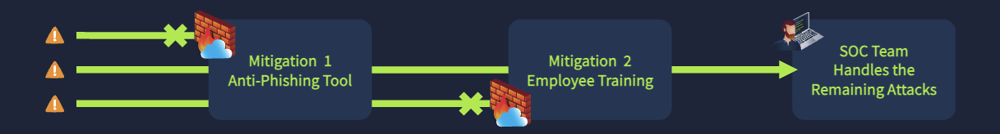
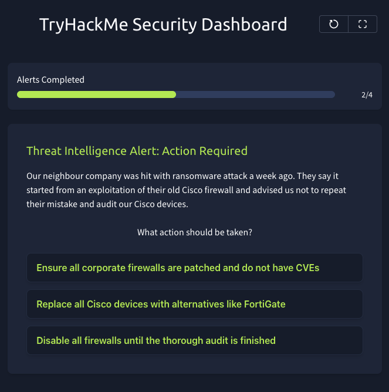

# Blue Team Introduction: SOC Level 1

**Platform:** TryHackMe | **Completed:** October 2026

## Key Skills

- Alert triage and escalation
- Identifying phishing indicators
- Distinguishing vulnerabilities from misconfigurations
- Acting on threat intelligence
- Defense-in-depth thinking

---

## Module 1: Junior Security Analyst Intro

**Summary:** Overview of a SOC analyst's day-to-day workflow: monitor alerts, investigate, escalate, and contain.

**Lab: Malicious IP Simulation**
- **Scenario:** Two critical SIEM alerts pointed to the same external IP: repeated unauthorized login attempts on port 22, followed by a successful SSH login.
- **What I did:** Reviewed the alerts in the SIEM, [checked the IP's reputation in the IP lookup tool], escalated the incident, and blocked the IP on the firewall.
- **Takeaway:** Failed attempts followed by a success from one source is a classic sign of a successful brute-force attack, so it warrants immediate escalation and containment.

*Simulated SIEM alerts for a suspicious IP.*

---

## Module 2: SOC Role in Blue Team

**Summary:** Covers the roles within a SOC and when each is involved.

**Key concepts**
- **L1 analyst:** Triages alerts, escalates what exceeds their scope
- **L2 analyst:** Investigates escalated incidents in depth
- **Penetration testers:** Brought in to proactively test defenses

**SOC application:** Knowing when to escalate, and with what information, is a core L1 responsibility.

---

## Module 3: Humans as Attack Vectors

**Summary:** Attackers target people rather than systems, using trust and urgency to get access or information.

**Key concepts**
- **Social engineering:** Manipulating people into giving up access or data
- **Common methods:** Phishing, malicious downloads and links, AI/deepfake impersonation, fake job offers
- **Mitigation:** Anti-phishing tools, antivirus, security awareness training, "trust but verify"

*Layered mitigations reduce what reaches the SOC. Diagram: TryHackMe.*

**Lab: Security Task Dashboard**
- **Scenario:** Reviewed simulated alerts and decided which needed action.
- **Indicators I looked for:** Sender domain that didn't match the brand, a password-protected archive attachment, and a payment-confirmation pretext aimed at a finance role.
- **Takeaway:** Any one indicator may be innocent, but several together justify escalating.

*Simulated SIEM alert for a suspicious email attachment.*

**SOC application:** User-reported phishing is one of the most common alerts an L1 analyst handles.

---

## Module 4: Systems as Attack Vectors

**Summary:** Attackers exploit weaknesses in systems and software rather than people.

**Key concepts**
- **Supply chain attack:** Attackers compromise a less-secure vendor or software supplier to reach their real target through trusted software or access
- **Zero-day:** A vulnerability unknown to the developer, so defenders and attackers race to find it first
- **CVE:** A standardized identifier for a publicly disclosed vulnerability, which is used to track it and the patch for it
- **Misconfigurations:** Weak passwords and insecure settings that lead to breaches without any exploit

**Responses to misconfigurations:** Penetration testing, vulnerability scans, and configuration audits against security best practices.

**Lab: Configure or Patch**
- **Scenario:** Given a threat intelligence alert about attacks on a neighboring company's firewalls, I had to choose a response.

*Simulated threat intel alert requiring a response decision.*

**SOC application:** Threat intel from peers or vendors often leads to patching and audit tasks like this one.

---

## Key Takeaways

- Defense in depth: tools reduce attack volume, training reduces human error, and the SOC handles what remains
- Good triage means recognizing patterns across alerts, not judging each in isolation
- Mitigations should match the risk without disrupting the business
