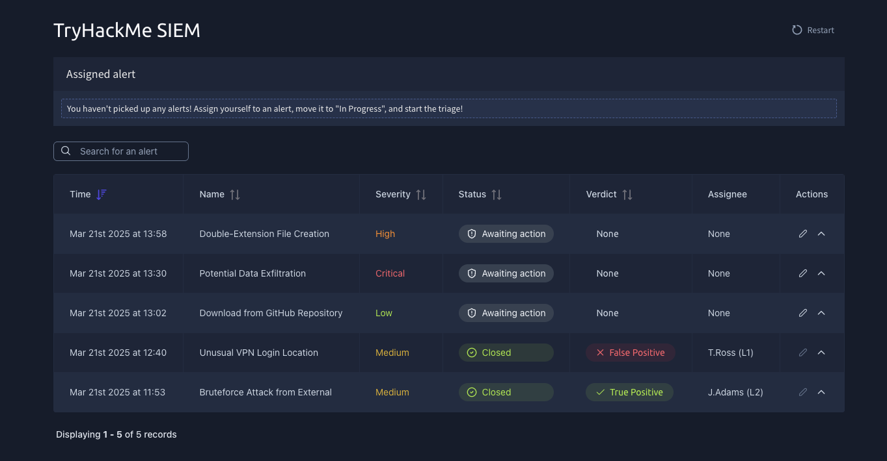
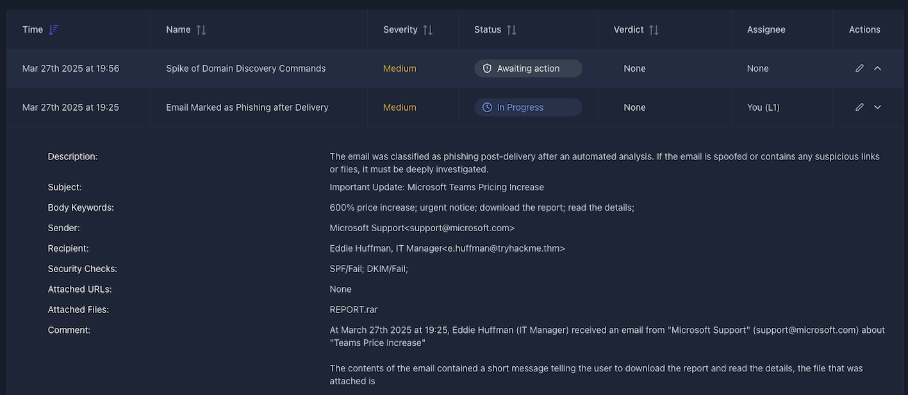
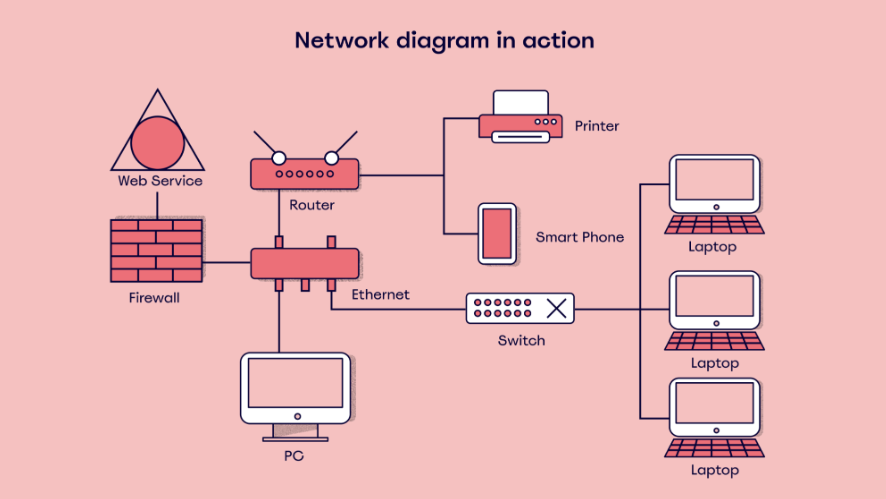

## SOC Team Internals: SOC Level 1

**Platform:** TryHackMe | **Completed** 

## Key Skills
- Alert prioritization and triage
- True positive vs. false positive assessment
- Writing structured alert reports (5 W's) and escalating to the right person
- Using SOC workbooks and lookup resources (identity inventory, asset inventory, network diagrams) to enrich alerts
- Understanding SOC performance metrics (MTTD, MTTA, MTTR)

---

## SOC L1 Alert Triage

**Summary:** Hands-on practice prioritizing and triaging alerts in a simulated SIEM queue, deciding which alerts are real threats and which need escalation.

**Key concepts**
- **Alert triage:** Reviewing each alert to decide whether it's a true positive (real threat) or a false positive (benign), and whether it needs escalation
- **Alert priority:** Severity ranking (critical, high, medium, low) that sets the order alerts are investigated. Severity is a starting point, not a verdict.
- **Triage workflow:** Assign the alert to yourself, move it to "In Progress," investigate, record a verdict, then close or escalate

**Tools used:** TryHackMe SIEM dashboard

**Lab: Alert Prioritization and Alert Triage**
- **Scenario:** Worked a queue of unassigned SIEM alerts ranked by severity.
- **What I did:** Triaged three alerts in priority order, from critical to high to low. For each one I read the alert details, [checked the context: user, host, source, and whether the activity fit normal behavior], and decided whether it was a real or potential threat or a false positive.
- **Takeaway:** [One specific lesson, e.g., "Severity alone doesn't decide the outcome: a low-severity alert can be a true positive, and a critical one can turn out benign once context is checked."] Good triage depends on reading the evidence in each alert and justifying the decision to escalate or close.

*TryHackMe SIEM alert queue before triage.*

**SOC application:** This mirrors an L1 analyst's core daily task: working an alert queue by priority and making a documented escalate-or-close decision on each one.

---

## SOC L1 Alert Reporting

**Summary:** Practiced writing structured alert reports in a simulated SIEM and deciding who each alert should be escalated to.

**Key concepts**
- **Alert reporting:** Documenting an alert clearly enough that the next person (an L2 analyst, a manager, or the affected team) can understand it and act without redoing the investigation
- **Report format (the 5 W's):**
  - **Who:** The user or account involved
  - **What:** The action or sequence of events
  - **When:** When the activity happened
  - **Where:** The device, IP address, or website involved
  - **Why:** The reasoning behind the final verdict
- **Escalation:** Routing the alert to the right person or team based on what it is and how serious it looks

**Tools used:** TryHackMe SIEM dashboard

**Lab: Alert Reporting and Escalation**
- **Scenario:** Reviewed multiple alerts in the SIEM dashboard, including a user-reported email flagged as phishing after delivery.
- **What I did:** Investigated each alert, wrote a report using the 5 W's format, and escalated each one to the appropriate staff member. For the email alert, I [checked the sender against the email security results, reviewed the attachment type, and looked at the message wording].
- **Takeaway:** [One specific lesson, e.g., "A report is only useful if the reader can act on it without asking follow-up questions." The 5 W's format forces me to cover the key facts every time.] It also builds a record I can learn from on future alerts.

*Alert detail view in the TryHackMe SIEM, used to gather the facts for the report.*

**SOC application:** L1 analysts write incident descriptions constantly, and a clear, consistent report speeds up the response for whoever receives the escalation.

---

## SOC Workbooks and Lookups

**Summary:** Covered how SOC workbooks guide an analyst through an alert, and which lookup resources (identity inventory, asset inventory, network diagrams) provide the context needed to triage it.

**Key concepts**
- **SOC workbook:** A step-by-step guide for handling a specific type of alert, so analysts respond consistently and newer analysts know what to check
- **Identity inventory:** A catalog of employees and service (machine) accounts, with their privileges, contact details, and roles in the company
- **Asset inventory:** A list of the computing resources in an organization's IT environment, which can include hardware, software, and sometimes employees
- **Network diagram:** A visual map of locations, subnets, and how they connect

*Example network diagram. Source: [https://miro.com/blog/network-diagram/].*

**High-quality triage steps**
1. **Enrichment:** Use threat intelligence tools and the identity inventory to gather information about the affected user or asset
2. **Investigation:** Combine that information with SIEM logs to decide whether the activity (for example, a login) is expected
3. **Escalation:** Escalate to L2, or contact the user to confirm, when the evidence calls for it

**Tools used:** TryHackMe SIEM dashboard, [workbook templates]

**Lab: Workbook Practice**
- **Scenario:** Wrote workbook steps for three alert scenarios, each needing a different set of checks and information to gather.
- **What I did:** Identified what each alert type required and wrote an ordered investigation process for it. [Name one scenario and the kind of checks you included, e.g., which lookup you'd consult first and why.]
- **Takeaway:** A workbook makes alerts less daunting, especially for new analysts, because the next step is already defined. [Add one lesson from writing them, e.g., what made a step clear versus vague.]

**SOC application:** Analysts follow workbooks daily for common alerts, and they write new ones when a recurring alert type doesn't have one yet. This keeps responses consistent and reduces the risk of missed steps.

---

## SOC Metrics and Objectives

**Summary:** Covered the core metrics SOCs use to measure how quickly they detect, pick up, and respond to threats, and why faster times reduce the damage an attacker can do.

**Key concepts**
- **Mean time to detect (MTTD):** The average time between when malicious activity starts and when the SOC detects it. A lower MTTD means the attacker has less time to operate unnoticed.
- **Mean time to acknowledge (MTTA):** The average time between an alert firing and an analyst acknowledging it and starting work. It reflects queue management, staffing, and how well alerts are prioritized.
- **Mean time to respond (MTTR):** The average time from detection to responding to the incident (containing or resolving it). Some teams define the "R" as "resolve" or "recover," so the exact start and end points vary by organization.

**How the metrics fit together**
1. Malicious activity begins
2. Detected by the SIEM or an analyst (**MTTD** measures this gap)
3. Alert acknowledged by an analyst (**MTTA** measures this gap)
4. Incident contained or resolved (**MTTR** measures this gap)

**Why they matter**
- Lower times mean less attacker dwell time and less damage
- Trends show where the process is slow: detection coverage (MTTD), alert handling (MTTA), or the response process (MTTR)
- Averages can hide outliers, so teams usually review them alongside individual high-severity incidents

**SOC objectives:** [Add 2-3 objectives from the module in your own words, e.g., what the SOC is trying to achieve beyond the metrics.]

**Takeaway:** [One lesson in your own words, e.g., "As an L1 analyst, I directly affect MTTA by picking up alerts quickly and MTTR by escalating with clear, complete information."]

**SOC application:** Managers track these numbers to judge whether the SOC is improving and where to invest in tools, training, or staffing. As an L1 analyst, working the queue by priority and escalating clearly feeds directly into MTTA and MTTR.

---